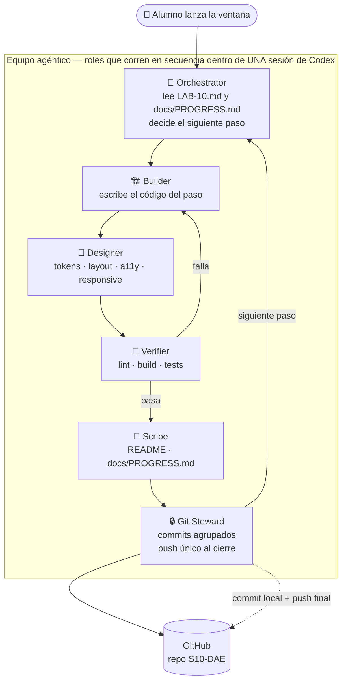
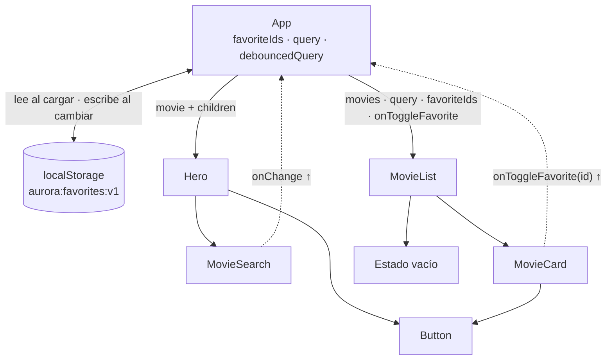

# S10-DAE — Lab 10: Componentes y eventos

Este proyecto extiende Aurora Cinemas del laboratorio 9 con componentes reutilizables y estado interactivo.
Se evalúan props, `useState`, eventos y comunicación del hijo al padre.
Rama de trabajo: `main`.

## Estructura agéntica



```text
 ┌────────────────────────── CICLO DE TRABAJO ──────────────────────────────┐
 │ [1 PLAN] → [2 BUILD] → [3 DESIGN] → [4 VERIFY] → [5 NOTES] → [6 COMMIT] │
 │     ▲                         │                                  │       │
 │     └──────────────────── falla┘                     pasos agrupados    ▼
 │                                                  [7 PUSH FINAL] → [8 ESTADO]
 └──────────────────────────────────────────────────────────────────────────┘
```

## Arquitectura del laboratorio



## Árbol

```text
S10-DAE/
├── AGENTS.md · README.md
├── docs/PROGRESS.md
└── cinema-app/
    ├── public/posters/ (8 SVG originales)
    └── src/
        ├── main.jsx · App.jsx
        ├── data/movies.js · utils/favoritesStorage.js
        ├── styles/ (tokens · base · layout · forms · utilities)
        └── components/
            ├── Button/ · Header/ · Footer/
            ├── Hero/ · MovieSearch/ · MovieList/ · MovieCard/
        └── test/setup.js
```

## Comandos

Desde `cinema-app/`: `npm install`, `npm run dev`, `npm run lint`, `npm run build`, `npm test`.
Usa React 19, Vite 8, Vitest 5, Lucide y las fuentes Fraunces/Instrument Sans.

## Trabajo y diseño

Los pasos cercanos se agrupan en un commit local; el push se hace una vez al terminar. No se suben `node_modules`, `dist` ni secretos.
Aurora usa fondo oscuro, marfil y ámbar, tipografía editorial, tarjetas de póster, foco visible, teclado, landmarks y diseño adaptable.

## Terminado

La cartelera corre; botones, favoritas, búsqueda con debounce, filtro sin tildes, estado vacío y persistencia están listos; README y progreso describen la implementación; lint, build y pruebas pasan; cambios publicados en `origin`.
